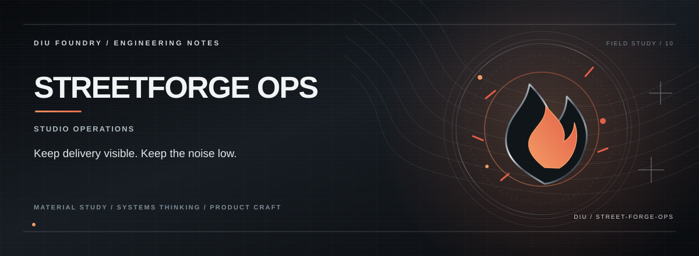

# STREETFORGE OPS

**A concept interface for resilient network operations, observability, and incident-response workflows.**

StreetForge Ops explores an operations-console experience for teams that need to understand system health, examine incidents, and consider recovery actions. Its current root route is a designed product experience with feature sections for predictive failure intelligence, network digital twins, an offline copilot, threat detection, root-cause analysis, and telemetry. Those descriptions outline the intended product direction; they do not prove that the underlying network integrations, machine-learning models, or air-gapped services are operational.

## The operator's mental model

```text
Observe service / network state
              │
              ▼
         Identify a signal
              │
              ▼
     Inspect context and history
              │
              ▼
       Compare recovery options
              │
              ▼
        Human review / action
```

## Product pillars

- **Observability:** Give operators a coherent place to inspect health signals.
- **Topology awareness:** Represent relationships between systems and routes.
- **Incident context:** Connect alerts with a useful explanation and timeline.
- **Offline-first ambition:** Design for restricted-connectivity environments, with implementation and security validation still required.
- **Human-led decisions:** Keep operational changes reviewable and reversible.

## Stack

React · TypeScript · Vite · TanStack Router / Start · React Query · Recharts · Tailwind CSS · Motion

## Run locally

**Requirements:** Node.js and Bun (recommended).

```bash
git clone https://github.com/Kishordiu/street-forge-ops.git
cd street-forge-ops
bun install
bun run dev
```

Use the local URL printed by Vite. To build and inspect the production bundle:

```bash
bun run lint
bun run build
bun run preview
```

## Operational boundary

The UI does not itself prove access to MPLS/BGP devices, live node telemetry, a local large language model, predictive forecasts, threat-detection sensors, or a genuinely air-gapped environment. Do not deploy it as a network operations or security control without implementing and testing the required services, permissions, monitoring, recovery procedures, and threat model.

---

<p align="center"><sub>DIU FOUNDRY · SECURE OPERATIONS / SYSTEMS DESIGN</sub></p>
